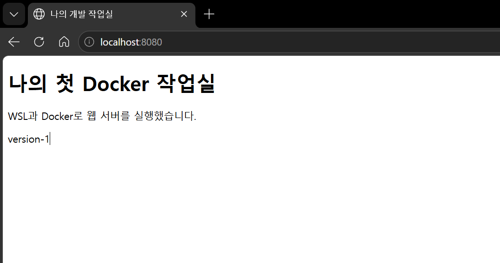
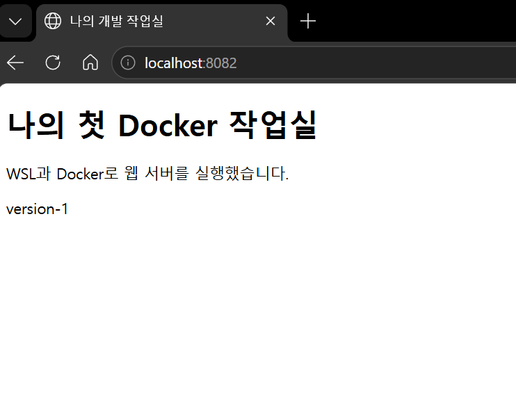
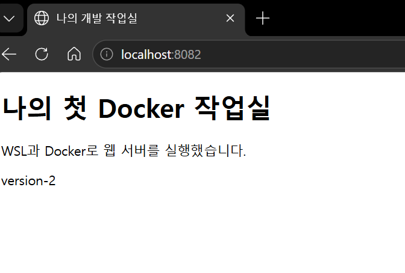
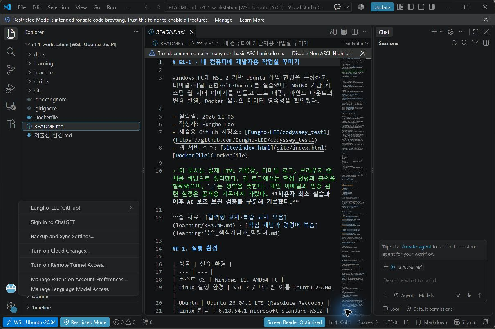

# E1-1 · 내 컴퓨터에 개발자용 작업실 꾸미기

Windows PC에 WSL 2 기반 Ubuntu 작업 환경을 구성하고, 터미널·파일 권한·Git·Docker를 실습했다. NGINX 기반 커스텀 웹 서버 이미지를 만들고 포트 매핑, 바인드 마운트의 변경 반영, Docker 볼륨의 데이터 영속성을 확인했다.

- 실습일: 2026-11-05
- 작성자: Eungho-Lee
- 제출용 GitHub 저장소: [Eungho-LEE/codyssey_test1](https://github.com/Eungho-LEE/codyssey_test1)
- 웹 서버 소스: [site/index.html](site/index.html) · [Dockerfile](Dockerfile)

> 이 문서는 실제 HTML 기록장, 터미널 로그, 브라우저 캡처를 바탕으로 정리했다. 긴 로그에서는 핵심 명령과 출력을 발췌했으며, `…`는 생략을 뜻한다. 개인 이메일과 인증 관련 설정은 공개용 기록에서 가렸다. 최초 실습과 이후 추가 검증 결과를 구분해 기록했다.

학습 자료: [입력형 교재·복습 교재 모음](learning/README.md) · [핵심 개념과 명령어 복습](learning/복습_핵심개념과_명령어.md)

1주차 부가과제(2026-11-10): [실행 방법·결과·학습 해설](bonus/README.md) · [Compose CLI 검증 로그](docs/records/bonus-compose.txt) · [SSH 검증 로그](docs/records/bonus-ssh.txt). Compose 단일 서비스, 멀티 컨테이너 통신, 운영 명령, 환경 변수 활용을 검증했고, GitHub SSH 공개키 등록·인증도 확인했다. 푸시 결과는 SSH 로그에서 확인한다.

## 1. 실행 환경

| 항목 | 실습 환경 |
| --- | --- |
| 호스트 OS | Windows 11, AMD64 PC |
| Linux 실행 환경 | WSL 2 / 배포판 이름 Ubuntu-26.04 |
| Ubuntu | Ubuntu 26.04.1 LTS (Resolute Raccoon) |
| Linux 커널 | 6.18.54.1-microsoft-standard-WSL2 |
| 쉘 | Bash, `/bin/bash` |
| 터미널·편집기 | Windows용 VSCode의 통합 터미널 / WSL 연결, 버전 별도 미기록 |
| Git | 2.53.0 |
| Docker Desktop | 4.98.0 |
| Docker CLI / Engine | 29.9.2 / 29.9.2, linux/amd64 |
| 웹 서버 베이스 | nginx:alpine, 응답에 표시된 NGINX 버전 1.31.8 |
| 컨테이너 Linux 이미지 | ubuntu:24.04 |
| 최초 실습 경로 | `/home/ox6965/codyssey/e1-1-workstation` (이후 호환 링크로 전환) |
| 현재 Windows 관리 경로 | `C:\Users\nabis\Desktop\Projects\codyssey\e1-1-workstation` |
| 현재 Ubuntu 접근 경로 | `/mnt/c/Users/nabis/Desktop/Projects/codyssey/e1-1-workstation` |

WSL Ubuntu의 버전과 컨테이너 Ubuntu의 버전은 서로 다른 실행 환경이므로 달라도 된다. 최초 권한 실습은 Ubuntu 홈 폴더에서 수행했다. 이후 관리 편의를 위해 Windows 프로젝트 폴더로 이전했다. Linux 고유 권한 실습을 다시 할 때는 [복습 교재](learning/복습_핵심개념과_명령어.md)의 Linux 임시 폴더 절차를 사용한다.

환경 증거: [WSL 배포판 목록](docs/records/step-00.txt), [Docker 설치·엔진 점검](docs/records/step-06.txt), [OS·쉘·Git 버전 기록](docs/records/step-13.txt), [문서 작성 시 재조회](docs/records/authoring-check.txt).

## 2. 수행 체크리스트와 검증 위치

| 항목 | 상태 | 검증 방법 및 증거 |
| --- | --- | --- |
| 터미널 기본 조작·경로 | 확인 | pwd, ls -la, touch, cp, mv, mkdir, rm, rmdir · [기록](docs/records/step-03.txt) |
| 파일 1개·디렉터리 1개 권한 변경 | 확인 | chmod 후 ls -ld 비교 · [기록](docs/records/step-04.txt) |
| Docker 버전·엔진 동작 | 확인 | docker --version, docker version, docker info · [기록](docs/records/step-06.txt) |
| hello-world 실행 | 확인 | Hello from Docker! · [터미널 로그](docs/logs/07-containers.txt) |
| Ubuntu 컨테이너 내부 진입 | 확인 | bash 진입 및 컨테이너 안 pwd · [터미널 로그](docs/logs/07-containers.txt) |
| attach·exec·분리 비교 | 보완 확인 | 별도 컨테이너에서 exec 쉘 종료·attach 분리 후 Running=true 확인 · [실제 보완 로그](docs/records/supplement-attach-exec.txt) |
| 이미지·컨테이너 운영 | 확인 | pull, images, start, stop, ps, ps -a, logs, stats · [기록](docs/records/step-08.txt) |
| 직접 작성한 Dockerfile·빌드 | 확인 | e11-web:1.0 생성 · [기록](docs/records/step-09.txt) |
| 포트 매핑·브라우저 접속 | 확인 | 8080 → 80, HTTP 200과 주소창 캡처 · [기록](docs/records/step-10.txt) |
| 바인드 마운트 변경 반영 | 확인 | 8082에서 version-1 → version-2 · [기록](docs/records/step-11.txt) |
| 볼륨 영속성 | 확인 | 컨테이너 A 삭제 후 B에서 동일 데이터 조회 · [기록](docs/records/step-12.txt) |
| Git 작성자·기본 브랜치·커밋 | 확인 | git config --list, main, 커밋 이력 · [설정](docs/records/git-config.txt), [초기 커밋](docs/records/step-05.txt) |
| GitHub 원격 연결 | 연결 확인 | origin 연결 및 기존 main 이력 fetch · [연결 기록](docs/records/remote-connected.txt) |
| GitHub 푸시·VSCode 연동 | 확인 | main 업로드 및 로컬·원격 SHA 일치 · [푸시 기록](docs/records/push-proof.txt), [로그인 캡처](docs/images/14-vscode-github-account.png) |
| 트러블슈팅 2건 이상 | 확인 | 실제 발생·해결 기록 3건을 10절에 정리 |

최초 증거인 **8080의 이미지 실행과 8082의 마운트 실행**에 더해, 보완 검증으로 같은 원본 이미지의 **8081 접속**과 새 위치에서 빌드한 **8090 접속**을 추가 확인했다. [보완 빌드·HTTP 200 로그](docs/records/supplement-web.txt)

## 3. 저장소 구성

```text
.
├─ README.md
├─ Dockerfile
├─ .dockerignore
├─ .gitignore
├─ site/
│  └─ index.html
├─ learning/                # 입력형 HTML 교재와 핵심 개념 복습 교재
├─ scripts/                 # 실제 보완 검증 및 교재 HTML 생성 소스
└─ docs/
   ├─ images/
   │  ├─ 10-port-8080.png
   │  ├─ 11-bind-before.png
   │  └─ 11-bind-after.png
   ├─ records/              # HTML 기록장에서 추출한 명령·출력, 환경 재확인
   └─ logs/                 # script로 남긴 터미널 기록의 공개용 사본
```

HTML 기록장의 7단계에는 설치 점검 내용이 중복 기록되어 있어, 컨테이너 실습은 실제 `07-containers.txt` 로그로 확인했다. 원시 터미널 기록에는 입력 편집·화면 갱신의 흔적이 남아 있으므로 읽기 쉬운 HTML 추출 기록을 함께 제공한다. 자료 출처와 스크린샷 SHA-256은 [sources.json](docs/records/sources.json)에 있다.

구성 우선순위는 실행에 필요한 `Dockerfile`·`site/`, 검증에 필요한 `docs/`, 복습용 `learning/` 순이다. `docs/logs/`는 최초 터미널 기록, `docs/records/`는 기록장 추출·추가 검증, `docs/images/`는 화면 증거를 담는다. `scripts/`에는 검증·교재 생성 절차를 두었으며 일반 웹 서버 실행에는 필요하지 않다.

## 4. 터미널 조작과 파일 권한

### 4-1. 디렉터리·파일 조작

아래는 실제 기록에서 발췌한 명령과 출력이다.

```bash
$ cd practice/terminal
$ pwd
/home/ox6965/codyssey/e1-1-workstation/practice/terminal
$ touch empty.txt
$ printf 'Hello terminal\n' > memo.txt
$ cat memo.txt
Hello terminal
$ cp memo.txt copy.txt
$ mv copy.txt renamed.txt
$ mkdir archive
$ mv renamed.txt archive/
$ cat archive/renamed.txt
Hello terminal
$ rm archive/renamed.txt
$ rmdir archive
$ ls -la
# 목록에 empty.txt, memo.txt, 추가 복사본 12323ffy.txt가 남아 있고 archive는 없음
```

위 마지막 주석은 결과 해석이며 실제 ls 출력은 [전체 기록](docs/records/step-03.txt)에 있다. `touch`는 빈 파일, `cp`는 복사, `mv`는 이동·이름 변경, `rm`은 파일 삭제, `rmdir`은 빈 디렉터리 삭제에 사용했다. `ls -la`로 숨김 항목을 포함한 상세 목록을 확인했다.

- 절대 경로 예: `/home/ox6965/codyssey/e1-1-workstation/practice/terminal/memo.txt`
- 상대 경로 예: 과제 루트에서 `practice/terminal/memo.txt`
- `~`는 사용자 홈, `.`은 현재 디렉터리, `..`는 부모 디렉터리이다.

### 4-2. 권한 변경 전후

파일 `sample.txt`와 디렉터리 `sample-dir`에 서로 다른 권한을 적용한 후 원래의 644·755로 되돌렸다.

```bash
$ ls -ld practice/permissions/sample.txt practice/permissions/sample-dir
drwxr-xr-x 2 ox6965 ox6965 4096 Nov  5 18:00 practice/permissions/sample-dir
-rw-r--r-- 1 ox6965 ox6965   16 Nov  5 18:00 practice/permissions/sample.txt

$ chmod 600 practice/permissions/sample.txt
$ chmod 700 practice/permissions/sample-dir
$ ls -ld practice/permissions/sample.txt practice/permissions/sample-dir
drwx------ 2 ox6965 ox6965 4096 Nov  5 18:00 practice/permissions/sample-dir
-rw------- 1 ox6965 ox6965   16 Nov  5 18:00 practice/permissions/sample.txt

$ chmod 644 practice/permissions/sample.txt
$ chmod 755 practice/permissions/sample-dir
$ ls -ld practice/permissions/sample.txt practice/permissions/sample-dir
drwxr-xr-x 2 ox6965 ox6965 4096 Nov  5 18:00 practice/permissions/sample-dir
-rw-r--r-- 1 ox6965 ox6965   16 Nov  5 18:00 practice/permissions/sample.txt
```

세 숫자는 소유자·그룹·그 외 사용자의 순서다. `r=4`, `w=2`, `x=1`을 합산하므로 644는 `rw-r--r--`, 755는 `rwxr-xr-x`이다. 디렉터리의 x는 경로를 통과하고 내부에 접근하는 권한이다. [권한 전체 기록](docs/records/step-04.txt)

600·700은 소유자만 접근하도록 제한하는 실험이고, 644·755로 되돌려 일반 파일의 읽기 공유와 디렉터리 접근 차이를 비교했다. 파일의 x는 실행 권한이며, 디렉터리의 x는 그 경로를 통과하는 권한이라는 차이가 있다.

## 5. Docker 설치·컨테이너 운영

### 5-1. 설치 및 엔진 확인

```text
$ docker --version
Docker version 29.9.2, build a82e528

$ docker version
Client: Version 29.9.2 / OS/Arch linux/amd64
Server: Docker Desktop 4.98.0
Engine: Version 29.9.2 / OS/Arch linux/amd64

$ docker info
Server Version: 29.9.2
Operating System: Docker Desktop
OSType: linux
Architecture: x86_64
```

상세 출력에서 핵심 항목만 발췌했다. Client뿐 아니라 Server 정보가 나오는 것으로 엔진 연결을 확인했다. [전체 점검 기록](docs/records/step-06.txt)

엔진 연결이 안 되면 `docker version`·`docker info`의 Server 오류를 확인하고 Docker Desktop 실행 상태와 Ubuntu WSL Integration을 확인한다. `Cannot connect to the Docker daemon`은 점검 시 예상할 수 있는 오류의 예이며, 이 절의 성공 로그와 구분한다.

### 5-2. hello-world 및 Ubuntu 진입

```text
$ docker run --name e11-hello hello-world
Hello from Docker!
This message shows that your installation appears to be working correctly.

$ docker run -it --name e11-shell ubuntu:24.04 bash
root@56ca9f888082:/# pwd
/
root@56ca9f888082:/# exit
```

hello-world는 메시지 출력 후 종료하므로 `Exited (0)`가 정상이다. Ubuntu 컨테이너의 주 프로세스인 bash에서 `exit`하면 컨테이너도 멈춘다. `docker run`은 새 컨테이너 생성이고, 기존 컨테이너 재실행은 `docker start`이다. [실행·진입 로그](docs/logs/07-containers.txt)

`exec`는 실행 중인 컨테이너 안에 추가 명령·쉘을 만들고, `attach`는 주 프로세스의 입출력에 연결한다. 학습 중 VSCode에서 분리 단축키 문제를 겪었다. 보완 검증에서는 별도의 컨테이너를 만들고 **명시적인 분리 키 Ctrl+X, Ctrl+X**로 검사했다.

```text
$ docker exec 검증컨테이너 bash -lc 'pwd; ls /; echo EXEC_SESSION; exit 0'
/
…
EXEC_SESSION
$ docker inspect 검증컨테이너 --format '{{.State.Running}}'
true
$ docker attach --detach-keys=ctrl-x,ctrl-x 검증컨테이너
root@…:/# echo ATTACH_CONNECTED
ATTACH_CONNECTED
[Ctrl+X, Ctrl+X 전송]
read escape sequence
$ docker inspect 검증컨테이너 --format '{{.State.Running}}'
true
```

위 발췌의 검증컨테이너는 설명용 이름이며 실제 고유 이름·출력은 [보완 로그](docs/records/supplement-attach-exec.txt)에 있다. 현재 Docker CLI는 분리 시 `read escape sequence`와 종료 코드 1을 반환했으므로 코드 0으로 기록하지 않았다. 분리 후 주 컨테이너가 `Running=true`이며 명시적인 stop 후 `false`가 되는 것으로 유지·종료 차이를 확인했다. [실행한 검증 소스](scripts/verify_attach_exec.py)는 본인의 VSCode 키보드 충돌까지 해결했다는 뜻은 아니다.

### 5-3. 운영 명령

| 목적 | 수행 명령 | 실제 확인 결과 |
| --- | --- | --- |
| 이미지 다운로드 | docker pull nginx:alpine | Downloaded newer image |
| 이미지 목록 | docker images | hello-world, nginx:alpine, ubuntu:24.04 |
| 컨테이너 재시작 | docker start e11-lab | e11-lab 출력 |
| 실행 중·전체 목록 | docker ps / docker ps -a | Up 및 Exited 상태 구분 |
| 로그 | docker logs e11-hello | Hello from Docker! |
| 리소스 | docker stats --no-stream e11-lab | CPU 0.00%, MEM 1.848MiB / 15.27GiB |
| 중지 | docker stop e11-lab | 중지 후 Exited (137) 관찰 |

`Exited (137)`은 정상 종료 코드 0과는 다르므로 성공 코드라고 해석하지 않았다. 해당 실습에서는 stop 후 실행 상태가 종료 상태로 바뀐 것을 확인했다. [명령·출력 전체](docs/records/step-08.txt)

## 6. Dockerfile 기반 커스텀 이미지

[Dockerfile](Dockerfile)은 다음과 같이 직접 작성했다.

```dockerfile
FROM nginx:alpine
LABEL org.opencontainers.image.title="e11-workstation-web"
COPY site/ /usr/share/nginx/html/
EXPOSE 80
```

| 커스텀 항목 | 목적 |
| --- | --- |
| NGINX Alpine 베이스 선택 | 별도 웹 프레임워크 없이 정적 HTML을 제공하는 서버 기능 활용 |
| LABEL | 이미지 용도를 e11-workstation-web으로 식별 |
| COPY | 기본 웹 루트에 내가 만든 HTML을 넣어 기본 환영 페이지 교체 |
| EXPOSE 80 | 컨테이너의 서버 포트를 문서화. 실제 호스트 연결은 run의 -p로 설정 |

이미지는 프로그램·파일·설정·실행 정보를 담은 패키지이고, 컨테이너는 그 이미지로 만들어 실행하는 환경이다. 이미지가 존재하는 것과 서버가 실행 중인 것은 다르다.

```text
Dockerfile + site/ → docker build → 이미지 → docker run → 실행 중인 컨테이너
```

```text
$ docker build --progress=plain -t e11-web:1.0 .
#6 [2/2] COPY site/ /usr/share/nginx/html/
#6 DONE 0.1s
#7 naming to docker.io/library/e11-web:1.0 done
#7 DONE 0.2s

$ docker images e11-web
IMAGE         ID             DISK USAGE   CONTENT SIZE
e11-web:1.0   e56ff6542972       93.6MB         26.3MB
```

빌드 당시 베이스 digest는 다음과 같다.

```text
nginx@sha256:785835ea65db4bba6f021acc0f3be91b0fef76a53fe41f8588c6698d2aed0606
```

`nginx:alpine` 태그의 내용은 향후 달라질 수 있다. 동일 베이스가 필요한 경우 위 digest를 참조할 수 있다. [Dockerfile 작성·빌드 기록](docs/records/step-09.txt)

캐시 문제를 점검할 때는 `docker build --no-cache -t e11-web:review .`로 레이어 캐시 없이 빌드할 수 있고, 베이스 갱신은 `--pull`로 별도 확인한다. 이는 재시도 방법 설명이며 이번 로그에서 두 옵션을 실행했다고 주장하는 것은 아니다.

## 7. 포트 매핑과 바인드 마운트

### 7-1. 이미지 기반 서버: 호스트 8080 → 컨테이너 80

```text
$ docker run -d --name e11-web-8080 -p 127.0.0.1:8080:80 e11-web:1.0
44728c17656a09e52efb13ee729fdbac72f50a3e98453ed6050eb1db951295c9
$ docker port e11-web-8080
80/tcp -> 127.0.0.1:8080
$ curl -i http://localhost:8080
HTTP/1.1 200 OK
Server: nginx/1.31.8
Content-Type: text/html
…
<p id="version">version-1</p>
```

컨테이너 내부 서버는 80번에서 요청을 받는다. `-p 127.0.0.1:8080:80`은 내 PC의 8080 접속을 컨테이너 80에 전달한다. [실행·HTTP 응답 기록](docs/records/step-10.txt)

컨테이너의 네트워크 네임스페이스는 네트워크 인터페이스·주소·포트 공간을 분리한다. 따라서 컨테이너 안의 80번 포트를 호스트 8080으로 전달하는 설정이 필요하다. 이번 `127.0.0.1` 바인딩은 로컬 접속용이므로 다른 PC에서 접근되지 않는 것이 의도한 동작이다. 접속 문제는 `docker ps`, `docker port`, 호스트의 `curl.exe -i http://127.0.0.1:8080`, 브라우저의 같은 URL 순으로 확인한다. 충돌 진단·해제와 실제 로그는 아래 문제 4에 정리했다.



### 7-2. 마운트 기반 서버: 호스트 8082 → 컨테이너 80

```bash
docker run -d --name e11-web-bind -p 127.0.0.1:8082:80 --mount "type=bind,source=$(pwd)/site,target=/usr/share/nginx/html,readonly" e11-web:1.0
docker inspect e11-web-bind --format '{{json .Mounts}}'
```

실제 Mounts 출력에서 `Type=bind`, Source가 과제의 `site` 폴더, Destination이 `/usr/share/nginx/html`, `RW=false`임을 확인했다. 호스트의 파일을 컨테이너에서 읽기 전용으로 보도록 연결한 것이다.

**변경 전:** 8082에서 `version-1`을 확인했다.



```bash
$ sed -i 's/version-1/version-2/' site/index.html
$ curl -s http://localhost:8082
…
<p id="version">version-2</p>
$ curl -s http://localhost:8080
…
<p id="version">version-1</p>
```

**변경 후:** 재빌드 없이 8082가 `version-2`로 바뀌었다.



8080은 이미지에 복사된 파일을 사용하여 version-1을 유지하고, 8082는 현재 호스트 파일을 연결하여 version-2를 보여준다. 바인드 마운트는 호스트 수정 반영에 활용할 수 있다. [호스트 파일·응답 전후 전체 기록](docs/records/step-11.txt)

호스트 source 경로는 실제 존재하는 `site/`의 절대 경로이고 컨테이너 target은 NGINX 웹 루트 `/usr/share/nginx/html/`이다. 재현 시 `pwd`, `ls site/index.html`, `docker inspect … --format '{{json .Mounts}}'`로 양쪽 위치가 의도대로 연결됐는지 확인한다.

## 8. Docker 볼륨 영속성

이름 있는 볼륨 `e11-data`를 `/data`에 연결했다. 볼륨 안에는 영속 파일, 볼륨 밖에는 비교용 임시 파일을 작성했다.

```bash
$ docker volume create e11-data
e11-data
$ docker run -d --name e11-vol-a --mount type=volume,source=e11-data,target=/data ubuntu:24.04 sleep infinity
$ docker exec e11-vol-a bash -lc 'echo "my-persistent-record" > /data/proof.txt; echo "temporary-record" > /tmp/local-only.txt'
$ docker exec e11-vol-a cat /data/proof.txt
my-persistent-record
$ docker exec e11-vol-a cat /tmp/local-only.txt
temporary-record
$ docker stop e11-vol-a
e11-vol-a
$ docker rm e11-vol-a
e11-vol-a
$ docker ps -a --filter name=e11-vol-a
CONTAINER ID   IMAGE     COMMAND   CREATED   STATUS    PORTS     NAMES
```

같은 볼륨을 새 컨테이너 B에 연결했다.

```bash
$ docker run -d --name e11-vol-b --mount type=volume,source=e11-data,target=/data ubuntu:24.04 sleep infinity
$ docker exec e11-vol-b cat /data/proof.txt
my-persistent-record
$ docker exec e11-vol-b bash -lc 'if [ -e /tmp/local-only.txt ]; then cat /tmp/local-only.txt; else echo "temporary file is absent"; fi'
temporary file is absent
```

컨테이너 A를 실제 삭제한 뒤에도 볼륨의 데이터는 B에서 유지됐다. 볼륨 밖 임시 파일은 새 컨테이너에 없었다. 따라서 컨테이너의 쓰기 영역과 이름 있는 볼륨의 수명이 다름을 확인했다. [생성·연결·삭제·재검증 전체 기록](docs/records/step-12.txt)

이름 있는 볼륨 자체를 삭제하면 그 데이터는 유지되지 않는다. 중요한 데이터는 쓰기 작업을 중지한 일관된 시점에 파일 아카이브 또는 서비스별 백업을 별도 저장소로 내보내고, 새 볼륨에 복원·검증한 뒤 정리한다. 이번 실습에서는 원본 데이터 볼륨을 삭제하거나 복구 실험을 하지는 않았다.

## 9. Git 설정과 GitHub 제출 상태

Git은 로컬 변경 이력을 관리하고, GitHub는 원격 저장소를 보관·공유하는 서비스이다. `commit`은 로컬 기록이고 `push`가 원격 업로드이다.

원격 접근 실패 시 `git remote -v`의 주소, `git status`·`git branch -vv`의 브랜치·추적 상태, `gh auth status`의 로그인 계정을 확인하고 push 오류의 401/403 또는 repository not found 문구를 기록한다. 저장소 공개 범위·계정 접근 권한을 함께 확인하며 토큰 값은 출력·첨부하지 않는다.

```text
$ git config --list
user.name=Eungho-Lee
user.email=[이메일 마스킹]
init.defaultbranch=main
core.repositoryformatversion=0
core.filemode=true
core.bare=false
core.logallrefupdates=true
```

초기 커밋 `5779ef8`과 웹 서버 실습 커밋 `370328e`를 만들었고, 문서 작성 시 main의 최신 커밋은 `9bd7811 docs: update practice logs`였다. [초기 설정·커밋](docs/records/step-05.txt), [현재 설정](docs/records/git-config.txt), [문서 작성 시 상태](docs/records/authoring-check.txt)

처음에는 GitHub에 `codyssey_test1` 저장소만 만들었고 로컬에는 원격 연결이 없었다. 이후 사용자 요청으로 기존 GitHub CLI 인증을 사용하여 origin을 연결하고 원격 이력을 가져왔다. 인증 토큰을 문서·파일에 저장하지 않았다. 이후 생성하는 커밋의 작성자 이메일은 GitHub noreply 주소를 사용한다.

```text
$ git remote -v
origin  https://github.com/Eungho-LEE/codyssey_test1.git (fetch)
origin  https://github.com/Eungho-LEE/codyssey_test1.git (push)
```

[원격 연결 기록](docs/records/remote-connected.txt) · [연결 전 기록](docs/records/step-14.txt). 원격의 초기 README 커밋 `03d34cb`는 병합 커밋 `6429e61`로 로컬 이력과 함께 보존했다. 원격 README 원문도 [별도 기록](docs/records/github-initial-README.md)에 남겼다. [병합 과정](docs/records/history-integration.txt)

공개 범위에 대한 사용자 승인 후 main을 업로드했다. 최초 업로드 확인 커밋은 `d7de957`이며, push 성공과 로컬 HEAD·원격 main의 동일 SHA를 확인했다. 이후 문서·증거 보완분도 main에 반영한다. [실제 푸시 기록](docs/records/push-proof.txt)

VSCode의 WSL 과제 작업 공간에서 Accounts 메뉴의 `Eungho-LEE (GitHub)` 로그인을 확인했다. 새 WSL 경로의 폴더 신뢰는 사용자가 직접 적용했고, Restricted Mode 표시가 사라짐도 확인했다.



## 10. 트러블슈팅

### 문제 1. Dockerfile 지시문을 터미널에서 실행

- **문제:** `FROM nginx:alpine`과 `LABEL …` 입력 시 `command not found`가 발생했다.
- **원인 가설:** Linux 쉘 명령과 Dockerfile에 작성할 지시문을 혼동했다.
- **확인:** 터미널 기록에 `FROM: command not found`, `LABEL: command not found`가 있었고 Dockerfile을 아직 만들지 않은 상태였다.
- **해결:** `cat > Dockerfile <<'EOF'`를 사용해 네 줄을 파일로 저장하고 `cat Dockerfile`로 확인했다. 이후 `docker build`가 성공하고 `e11-web:1.0` 이미지가 생성됐다.
- **증거:** [오류·수정·빌드 성공 기록](docs/records/step-09.txt)

### 문제 2. 잘못된 작업 위치에서 이미지 빌드

- **문제:** `/mnt/c/Users/nabis`에서 빌드해 `failed to read dockerfile: open Dockerfile: no such file or directory`가 발생했다. 생성되지 않은 verify 이미지를 실행하려다 실패했고 8090 curl 접속도 실패했다.
- **원인 가설:** 마지막 `.`이 지정한 빌드 컨텍스트에 Dockerfile이 없다.
- **확인:** `practice` 폴더에서도 같은 오류를 재현하고 `pwd`, `ls -la`로 Dockerfile이 없음을 확인했다. 과제 루트에서 `ls -l Dockerfile`은 파일을 표시했다.
- **해결:** 당시에는 과제 루트에서 `docker build -t e11-web:check .` 빌드 성공까지 기록했다. 이후 보완 검증에서는 새 작업 위치에서 verify 이미지를 빌드하고 8090 HTTP 200·version-2까지 확인했다. [후속 성공 기록](docs/records/supplement-web.txt)
- **증거:** [빌드 위치 오류·check 태그 빌드 성공](docs/records/step-13.txt)

### 문제 3. 여러 줄 파일 입력의 종료 구분자 혼동

- **문제:** HTML 작성 중 소문자 `eof`를 입력하고 `cat site/index.html`까지 이어 적었더니 두 줄이 HTML 파일 내용에 포함됐다.
- **원인 가설:** 시작 시 지정한 구분자 `EOF`와 소문자 `eof`가 다르므로 입력 종료로 인식되지 않았다.
- **확인:** `cat site/index.html` 출력 끝에 `eof`와 `cat site/index.html` 문자열이 들어 있었다.
- **해결:** `cat > site/index.html <<'EOF'`로 HTML 전체를 다시 작성하고 단독 대문자 `EOF`로 종료했다. 다시 출력해 불필요한 줄이 사라진 정상 HTML을 확인했다.
- **증거:** [HTML 입력 오류·재작성 기록](docs/records/step-09.txt)

### 문제 4. 포트 충돌 진단·해제·재시작 — 평가 항목 #16 보완

평가 보완을 위해 다른 서비스가 사용하지 않는 **호스트 18080번 포트**에서 두 개의 별도 컨테이너로 충돌을 재현했다. 아래는 실제 명령·결과의 요약이며 [전체 실행 로그](docs/records/port-conflict.txt)와 [재현 스크립트](scripts/verify_port_conflict.cjs)를 함께 제공한다. Windows 프로세스 조회는 PowerShell에서, Docker 명령은 Ubuntu 터미널에서 실행한다.

**① 문제 재현과 원인 가설**

```bash
docker run -d --name e11-port-conflict-owner -p 127.0.0.1:18080:80 nginx:alpine
docker run -d --name e11-port-conflict-retry -p 127.0.0.1:18080:80 nginx:alpine
```

두 번째 실행은 종료 코드 125와 `Bind for 127.0.0.1:18080 failed: port is already allocated`를 반환했다. 컨테이너 이름 충돌이 아닌 **같은 호스트 주소·포트의 중복 바인딩**을 원인으로 가정했다. [오류 로그 6–15행](docs/records/port-conflict.txt#L6-L15)

**② 포트 점유 PID와 프로세스 확인 — Windows PowerShell**

```powershell
$listeners = Get-NetTCPConnection -State Listen -LocalPort 18080 -ErrorAction SilentlyContinue
$listeners | Select-Object LocalAddress,LocalPort,OwningProcess
$listeners | ForEach-Object { Get-Process -Id $_.OwningProcess }
```

실제 조회 결과는 `LocalAddress=127.0.0.1`, `LocalPort=18080`, `OwningProcess=46604`, `ProcessName=com.docker.backend`였다. PID는 실행 시마다 달라지므로 예시 숫자를 고정해 종료하지 않는다. [PID·프로세스 로그 16–18행](docs/records/port-conflict.txt#L16-L18)

**③ 실제 점유 컨테이너와 포트 바인딩 확인 — Ubuntu**

```bash
docker ps --filter publish=18080 --format 'table {{.Names}}\t{{.Status}}\t{{.Ports}}'
docker port e11-port-conflict-owner
docker inspect e11-port-conflict-owner --format '{{json .HostConfig.PortBindings}}'
```

실제 컨테이너는 `e11-port-conflict-owner`, 포트 출력은 `80/tcp -> 127.0.0.1:18080`, 설정은 `{"80/tcp":[{"HostIp":"127.0.0.1","HostPort":"18080"}]}`였다. Windows에서 Docker backend PID가 보이더라도 종료 대상은 **확인된 점유 컨테이너**다. [바인딩 로그 19–28행](docs/records/port-conflict.txt#L19-L28)

**④ 점유 컨테이너 중지 후 포트 해제 확인**

```bash
docker stop --timeout 3 e11-port-conflict-owner
```

Windows PowerShell에서 ②의 `Get-NetTCPConnection`을 다시 실행했다. 로그의 JSON 조회 결과가 `[]`가 되어 18080 LISTEN 항목이 사라진 것을 확인했다. [중지·포트 해제 로그 30–36행](docs/records/port-conflict.txt#L30-L36)

Docker backend 프로세스를 강제 종료하면 다른 컨테이너에 영향을 줄 수 있으므로 이번에는 PID 강제 종료를 사용하지 않았다. 일반 프로그램이 점유한 경우에도 프로세스 이름·용도를 확인하고 해당 프로그램의 정상 종료 방법을 먼저 사용한다. 기존 서비스를 유지해야 한다면 다른 **비어 있는 호스트 포트**를 선택하고 브라우저 URL도 바꾼다. 예를 들어 18081–18089를 후보로 조회할 수 있으나 그 범위가 항상 비어 있다는 보장은 없다.

**⑤ 실패한 컨테이너를 재생성하고 재시작·접속 확인**

이번 환경에서는 충돌로 실패한 컨테이너를 단순 `docker start`했을 때 실행 상태는 바뀌어도 `docker port`가 비어 있고 접속이 거절됐다. [중간 진단 기록](docs/records/port-conflict-restart-attempt.txt). 따라서 이번 검증에서 만든 실패 컨테이너만 삭제하고, 같은 포트 설정으로 다시 생성한 뒤 명시적으로 재시작했다.

```bash
docker rm e11-port-conflict-retry
docker run -d --name e11-port-conflict-retry -p 127.0.0.1:18080:80 nginx:alpine
docker restart --timeout 3 e11-port-conflict-retry
docker port e11-port-conflict-retry
```

Windows PowerShell에서 다음으로 HTTP 접속을 확인했다.

```powershell
curl.exe -i http://127.0.0.1:18080
```

실제 결과는 `HTTP/1.1 200 OK`, `Server: nginx/1.31.8`, 본문의 `Welcome to nginx!`였다. 재시작 후 포트 바인딩과 Windows LISTEN 항목도 다시 확인했다. [재생성·재시작 로그 37–51행](docs/records/port-conflict.txt#L37-L51), [HTTP 응답·실행 상태 52–101행](docs/records/port-conflict.txt#L52-L101)

**⑥ 검증 종료와 정리**

```bash
docker stop --timeout 3 e11-port-conflict-owner e11-port-conflict-retry
docker rm e11-port-conflict-owner e11-port-conflict-retry
```

위는 개별 실행한 정리 명령을 합쳐 표시한 예이다. 실제 로그에서는 이름별 stop·rm을 수행했고, 마지막 Windows 조회에서 `[]`를 확인했다. 기존 실습 컨테이너·이미지·데이터 볼륨은 삭제하지 않았다. [정리·최종 포트 해제 102–117행](docs/records/port-conflict.txt#L102-L117)

핵심 순서는 **오류 확인 → 호스트 점유 PID 확인 → Docker 컨테이너·바인딩 확인 → 점유 대상 중지 → 포트 해제 재조회 → 재생성·재시작 → HTTP 응답 확인 → 정리**이다.

## 11. 평가자 재현 방법

이 절은 **다시 실행할 절차**이다. 최초 8090 검증은 빌드 위치 오류로 실패했지만, 이후 새 작업 경로에서 다시 빌드·실행해 8090 HTTP 200과 version-2를 확인했다. 같은 원본 이미지로 실행한 8081은 version-1을 확인했다. [실제 보완 기록](docs/records/supplement-web.txt)

### 11-1. 준비

Windows에서 WSL 2, Ubuntu, Docker Desktop의 WSL 연동을 준비한다. Ubuntu에서 `docker version`의 Client·Server를 확인한다. GitHub 업로드 후 저장소를 clone하거나 제출된 전체 폴더를 받아 **Dockerfile이 있는 루트**에서 시작한다.

```bash
pwd
ls -l Dockerfile site/index.html
docker build -t e11-web:review .
docker run -d --name e11-review-web -p 127.0.0.1:8090:80 e11-web:review
curl -i http://localhost:8090
```

브라우저에서 `http://localhost:8090`을 연다. 제출된 현재 HTML은 마운트 실습 후의 **version-2**이므로 새 빌드도 version-2를 보여줘야 한다. 초기 e11-web:1.0의 version-1 기록과 시점이 다르다. 이름이나 포트가 이미 사용 중이면 새로운 이름·호스트 포트를 정하고 접속 주소도 같이 바꾼다.

### 11-2. 마운트 재현

```bash
docker run -d --name e11-review-bind -p 127.0.0.1:8092:80 --mount "type=bind,source=$(pwd)/site,target=/usr/share/nginx/html,readonly" e11-web:review
curl -s http://localhost:8092
```

`site/index.html`의 version-2를 다른 문구로 수정하고 8092를 다시 조회한다. 마운트 서버에는 반영되고, 이미지로만 실행한 8090에는 반영되지 않는지 비교한다. 필요하면 수정한 원본을 되돌린다.

### 11-3. 볼륨 재현

```bash
docker volume create e11-review-data
docker run -d --name e11-review-a --mount type=volume,source=e11-review-data,target=/data ubuntu:24.04 sleep infinity
docker exec e11-review-a bash -lc 'echo review-proof > /data/proof.txt'
docker exec e11-review-a cat /data/proof.txt
docker stop e11-review-a
docker rm e11-review-a
docker run -d --name e11-review-b --mount type=volume,source=e11-review-data,target=/data ubuntu:24.04 sleep infinity
docker exec e11-review-b cat /data/proof.txt
```

앞뒤 모두 `review-proof`가 출력되는지 확인한다. 새 이름을 사용하여 기존 실습 볼륨을 건드리지 않는다. 이 볼륨은 Git으로 전송되지 않으므로 재현할 때 직접 생성한다.

## 12. 폴더 이전과 추가 학습 자료

사용자 요청에 따라 과제를 기존 Windows 프로젝트 관리 위치로 이전했다. 최초 파일 103개를 복사·대조한 뒤 Linux 원본은 `/home/ox6965/codyssey/e1-1-workstation.backup-20261105`에 보존했다. 예전 `~/codyssey/e1-1-workstation`은 새 Windows 폴더를 가리키는 호환 링크다.

Docker 볼륨은 Docker가 계속 관리하고, WSL 배포판 자체도 별도로 유지된다. 파일 작업 공간만 이전한 것이다. 8082 읽기 전용 마운트 서버는 이전 로그를 보존한 후 새 `site` 경로로 재생성하여 HTTP 200과 version-2를 확인했다. [이전·마운트 검증](docs/records/relocation.txt)

```bash
cd /mnt/c/Users/nabis/Desktop/Projects/codyssey/e1-1-workstation
```

학습 자료는 [learning/README.md](learning/README.md)에 모았다. HTML은 내려받아 브라우저로 열고, Markdown은 GitHub에서 바로 읽을 수 있다. 복습 교재에는 경로·권한·이미지·컨테이너·포트·마운트·볼륨·Git 개념, 명령 예제와 옵션 해설, 자주 겪은 오류, 자가 점검 문제와 답이 있다.

## 13. 학습자료 · 핵심 개념과 터미널 명령어

이 자료는 실습 후 다시 이해하기 위한 교재입니다. 명령을 외우기보다 **어디에서, 무엇을 대상으로, 어떤 변화를 만드는지** 먼저 생각하세요. 예시 명령은 실제 수행 증거와 구분합니다.

### 1. 지금 내 작업 공간은 어디인가?

현재 과제의 기준 폴더는 다음 위치입니다.

```text
Windows: C:\Users\nabis\Desktop\Projects\codyssey\e1-1-workstation
Ubuntu:  /mnt/c/Users/nabis/Desktop/Projects/codyssey/e1-1-workstation
```

Windows와 Ubuntu가 **같은 파일**을 서로 다른 경로로 보는 것입니다. `C:` 드라이브가 Ubuntu에서는 `/mnt/c`에 연결됩니다. 파일을 옮겨도 Ubuntu 배포판 자체나 Docker 볼륨이 Windows 과제 폴더 안으로 옮겨지는 것은 아닙니다.

```bash
cd /mnt/c/Users/nabis/Desktop/Projects/codyssey/e1-1-workstation
pwd
ls -la
```

- `cd`: 작업 위치 이동. 성공해도 보통 출력이 없습니다.
- `pwd`: 현재 전체 경로를 표시합니다.
- `ls`: 목록. `-l`은 상세, `-a`는 숨김 항목 포함입니다.
- 이전 `~/codyssey/e1-1-workstation`은 새 폴더로 이어지는 호환 링크로 사용할 수 있습니다. 원래 Linux 폴더는 별도 백업으로 보관합니다.

| 표시 | 지금 있는 환경 |
| --- | --- |
| PS C:\…> | Windows PowerShell |
| ox6965@26susin:…$ | WSL Ubuntu 일반 사용자 쉘 |
| root@컨테이너ID:/# | Docker 컨테이너 안의 관리자 쉘 |

**VSCode 통합 터미널에서 Ubuntu가 실행되는 것**과 **VSCode 작업 공간 자체가 WSL에 연결되는 것**은 별개입니다. 왼쪽 아래의 WSL 표시로 연결을 확인합니다. Git 소유자 오류가 나면 Windows 쪽 Git으로 Linux 저장소를 열었는지도 확인하세요.

### 2. 명령 한 줄의 구조

```bash
mkdir -p docs/logs
```

| 부분 | 뜻 |
| --- | --- |
| mkdir | 폴더 만들기 |
| -p | 중간 부모 폴더까지 만들고 기존 폴더는 유지 |
| docs/logs | 만들 대상의 상대 경로 |

하이픈 옵션의 의미는 명령마다 다릅니다. `mkdir -p`의 p는 부모 경로, `docker run -p`의 p는 포트 연결입니다. `--name`처럼 긴 옵션은 보통 다음 값의 의미를 읽기 쉽게 표시합니다.

| 기호 | 뜻 | 예 |
| --- | --- | --- |
| ~ | 내 Ubuntu 홈 | ~/codyssey |
| / | Linux 경로 구분. 맨 앞이면 최상위에서 출발 | /home/ox6965 |
| . | 현재 디렉터리 | code . / docker build … . |
| .. | 부모 디렉터리 | cd .. |
| 큰따옴표 | 공백이 있어도 한 인수로 묶기. 변수 치환 가능 | echo "$SHELL" |
| 작은따옴표 | 안의 문자를 그대로 전달 | echo 'hello' |
| > | 출력으로 파일 생성·덮어쓰기 | echo hello > memo.txt |
| >> | 파일 끝에 덧붙이기 | echo next >> memo.txt |
| $(명령) | 명령 출력값을 그 위치에 넣기 | $(pwd)/site |
| ; | 앞 명령 성공 여부와 관계없이 다음 명령도 실행 | pwd; ls |
| && | 앞 명령이 성공했을 때 다음 실행 | cd site && ls |

`bash`라는 코드블록 제목은 “Bash에서 해석할 내용”이라는 표시이며 그 제목을 입력하라는 뜻이 아닙니다. `dockerfile`·`html` 표시는 파일 내용입니다.

### 3. 기본 파일 명령 복습

과제 파일을 건드리지 않도록 아래 예시는 별도 Linux 임시 폴더에서 합니다. `mktemp -d`는 이름이 겹치지 않는 새 디렉터리를 만듭니다.

```bash
practice_dir=$(mktemp -d /tmp/e11-review.XXXXXX)
cd "$practice_dir"
touch empty.txt
printf 'Hello terminal\n' > memo.txt
cat memo.txt
cp memo.txt copy.txt
mv copy.txt renamed.txt
mkdir archive
mv renamed.txt archive/
ls -la archive
rm archive/renamed.txt
rmdir archive
```

| 명령 | 하는 일 | 주의·확인 |
| --- | --- | --- |
| touch 파일 | 없으면 빈 파일 생성 | 기존 파일 내용은 지우지 않음 |
| printf | 형식에 맞춰 출력 | \n은 줄바꿈, >는 덮어쓰기 |
| cat 파일 | 파일 내용 읽기 | 파일을 실행하는 명령이 아님 |
| cp 원본 대상 | 파일 복사 | 원본 유지, 기존 대상 덮어쓰기 주의 |
| mv 원본 대상 | 이동 또는 이름 변경 | 원본 위치에서는 사라짐 |
| rm 파일 | 파일 삭제 | 휴지통을 거치지 않음 |
| rmdir 폴더 | 빈 폴더 삭제 | 내용이 남아 있으면 실패 |

`mkdir`, `cd`, `touch`, `cp`, `mv`, `chmod` 등은 성공해도 출력이 없을 수 있습니다. 프롬프트가 돌아왔는지, `pwd`·`ls` 등으로 결과를 확인하세요.

### 4. 권한 755·644 다시 읽기

```text
d | rwx | r-x | r-x
종류 소유자 그룹  그 외
```

`d`는 디렉터리, `-`는 일반 파일입니다. 읽기 r=4, 쓰기 w=2, 실행 x=1을 더합니다.

| 숫자 | 기호 | 허용 |
| --- | --- | --- |
| 7 | rwx | 읽기·쓰기·실행 |
| 6 | rw- | 읽기·쓰기 |
| 5 | r-x | 읽기·실행 |
| 4 | r-- | 읽기 |
| 0 | --- | 없음 |

- 755: 소유자는 전부, 그룹·그 외는 읽기·실행
- 644: 소유자는 읽기·쓰기, 그룹·그 외는 읽기
- 폴더의 x: 안으로 들어가고 경로를 통과할 수 있음
- 폴더의 w와 x: 내부 항목의 생성·삭제·이름 변경에 필요
- 파일 내용 수정 권한과 그 파일을 디렉터리에서 삭제할 권한은 서로 다른 문제

**현재 저장소는 Windows 파일 시스템 위에 있으므로 chmod 실습을 여기서 반복하지 않습니다.** Linux 고유 권한을 확인하려면 Ubuntu의 `/tmp`나 홈에 새 연습 폴더를 사용하세요. 최초 실습 증거는 이전 Linux 홈에서 수행한 기록입니다.

```bash
permissions_dir=$(mktemp -d /tmp/e11-permissions.XXXXXX)
touch "$permissions_dir/sample.txt"
mkdir "$permissions_dir/sample-dir"
chmod 600 "$permissions_dir/sample.txt"
chmod 700 "$permissions_dir/sample-dir"
ls -ld "$permissions_dir/sample.txt" "$permissions_dir/sample-dir"
chmod 644 "$permissions_dir/sample.txt"
chmod 755 "$permissions_dir/sample-dir"
ls -ld "$permissions_dir/sample.txt" "$permissions_dir/sample-dir"
```

`ls -ld`는 상세 정보(-l)를 폴더 내부가 아닌 폴더 자체(-d)에 대해 표시합니다. 출력의 이름·그룹·크기·수정 시각·경로를 권한과 함께 읽습니다.

### 5. Docker가 맡는 역할

Docker는 프로그램을 실행할 파일·설정·실행 정보를 이미지로 준비하고 컨테이너로 실행·관리합니다. 이번 웹 서버 이미지 안에는 NGINX, 라이브러리, NGINX 설정, 나의 HTML, 시작 명령 정보가 있습니다.

```text
Dockerfile + site/index.html + nginx 베이스
                  ↓ docker build
              e11-web 이미지
                  ↓ docker run
              웹 서버 컨테이너
                  ↓ 포트 연결
                 브라우저
```

| 개념 | 무엇인가? | 자주 하는 오해 |
| --- | --- | --- |
| Dockerfile | 이미지를 만드는 지시문 파일 | FROM을 Ubuntu 명령으로 실행하지 않음 |
| 이미지 | 파일과 실행 정보를 저장한 패키지 | 다운로드만으로 서버가 켜지지 않음 |
| 컨테이너 | 이미지로 만든 실행 환경 | 멈춘 것과 삭제한 것은 다름 |
| Docker CLI | docker 명령을 받는 도구 | CLI 버전만 보여도 엔진 연결 성공은 아님 |
| Docker 엔진 | 이미지·컨테이너를 실제 관리 | Docker Desktop 엔진이 꺼지면 실행 실패 |

### 6. Dockerfile 한 줄씩

```dockerfile
FROM nginx:alpine
LABEL org.opencontainers.image.title="e11-workstation-web"
COPY site/ /usr/share/nginx/html/
EXPOSE 80
```

| 지시문 | 뜻 |
| --- | --- |
| FROM | nginx:alpine 이미지를 출발점으로 삼음. nginx는 이름, alpine은 태그 |
| LABEL | 이미지에 설명용 메타데이터 추가 |
| COPY | 빌드 컨텍스트의 site 내용을 이미지 웹 루트에 복사 |
| EXPOSE | 80번 포트를 쓴다는 정보. 실제 접속 연결은 -p로 별도 지정 |

```bash
docker build -t e11-web:review .
docker images e11-web
```

`-t`는 이름:태그, 마지막 `.`은 현재 폴더를 빌드 컨텍스트로 지정합니다. Dockerfile이 없는 폴더에서 실행하면 실패합니다. `pwd`, `ls -l Dockerfile site/index.html`부터 확인하세요.

### 7. run과 start, exec와 attach

```bash
docker run -it --name review-shell ubuntu:24.04 bash
```

`run`은 새 컨테이너 만들기입니다. `-i`는 입력 유지, `-t`는 가상 터미널, `--name`은 이름, `ubuntu:24.04`는 이미지, 마지막 `bash`는 시작할 프로그램입니다. 이미지 이름 자리에 사용자 이름을 넣으면 Docker는 그 이름의 이미지를 찾습니다.

주 bash에서 `exit` 후 다시 들어갈 때는 새 run이 아닌 다음 명령을 씁니다.

```bash
docker start -ai review-shell
```

`-a`는 주 프로세스 출력에 연결, `-i`는 입력 연결입니다. 기존 컨테이너의 이미지·시작 명령이 저장돼 있으므로 다시 쓰지 않습니다.

추가 쉘과 주 쉘의 차이는 별도 컨테이너로 연습합니다.

```bash
docker run -dit --name review-lab ubuntu:24.04 bash
docker exec -it review-lab bash
```

위 exec로 들어간 뒤 `exit`하면 추가 쉘만 종료합니다. 호스트에서 아래를 확인합니다.

```bash
docker ps --filter name=review-lab
docker attach --detach-keys="ctrl-x,ctrl-x" review-lab
```

attach는 주 bash에 연결합니다. **Ctrl+X를 두 번** 누르면 연결만 분리합니다. 이 키는 이번 attach에 지정한 키이고 기본 분리 키는 Ctrl+P, Ctrl+Q입니다. VSCode가 단축키를 먼저 처리하면 사용자 환경별 조정이 필요할 수 있습니다.

| 동작 | 주 bash 상태 | 컨테이너 |
| --- | --- | --- |
| exec로 연 추가 bash에서 exit | 유지 | 계속 실행 |
| attach 연결 후 분리 키 | 유지 | 계속 실행 |
| attach된 주 bash에서 exit | 종료 | 멈춤 |
| docker stop | 종료 요청 | 멈춤 |
| docker rm | 해당 없음 | 컨테이너 삭제 |

**호스트 프롬프트($)와 컨테이너 프롬프트(root@…#)를 먼저 구분**하세요. 컨테이너 안에서 Docker를 조작할 필요는 없습니다.

### 8. 포트·이미지 복사·바인드 마운트·볼륨

```bash
docker run -d --name review-web -p 127.0.0.1:8093:80 e11-web:review
curl -i http://localhost:8093
```

`-d`는 백그라운드 실행입니다. `127.0.0.1:8093:80`은 내 PC의 8093을 컨테이너 80으로 전달합니다. localhost는 내 PC입니다. `curl -i`는 HTTP 헤더도 보여주므로 200 OK와 HTML을 확인할 수 있습니다. curl 성공과 주소창을 포함한 브라우저 캡처는 각각 다른 증거입니다.

```bash
docker run -d --name review-bind -p 127.0.0.1:8094:80 --mount "type=bind,source=$(pwd)/site,target=/usr/share/nginx/html,readonly" e11-web:review
```

`type=bind`는 호스트 경로 연결, `source`는 원본, `target`은 컨테이너 위치입니다. `readonly`는 컨테이너에서 읽기 전용이라는 뜻이며 호스트 편집은 가능합니다. 파일이 이미지에 복사된 것과 호스트 폴더를 실시간 연결한 것은 다릅니다.

| 방식 | 원본·관리 주체 | 주로 사용하는 목적 |
| --- | --- | --- |
| Dockerfile COPY | 빌드 때 파일을 이미지에 복사 | 배포할 코드·정적 콘텐츠 |
| 바인드 마운트 | 내가 관리하는 호스트 폴더 | 소스 수정 즉시 반영 |
| 이름 있는 볼륨 | Docker가 관리하는 저장 공간 | 컨테이너를 바꿔도 유지할 데이터 |

```bash
docker volume create review-data
docker run -d --name review-volume --mount type=volume,source=review-data,target=/data ubuntu:24.04 sleep infinity
docker exec review-volume bash -lc 'echo proof > /data/proof.txt'
docker exec review-volume cat /data/proof.txt
```

볼륨 증명은 여기서 끝이 아닙니다. 컨테이너를 삭제하고 새 컨테이너에 **같은 볼륨을 연결한 뒤** 파일을 다시 읽어야 합니다. `sleep infinity`는 계속 기다리는 주 프로세스로 컨테이너를 유지합니다. `bash -lc`는 로그인 쉘 설정을 읽고 뒤의 문자열을 명령으로 실행합니다.

### 9. Docker 운영 명령 사전

| 명령 예 | 뜻·읽을 결과 |
| --- | --- |
| docker --version | CLI 버전 |
| docker version | Client·Server 버전. 엔진 연결 확인 |
| docker info | 엔진 상태·운영 환경 |
| docker pull nginx:alpine | 이미지 다운로드 |
| docker images | 이미지 목록 |
| docker ps | 실행 중 컨테이너 |
| docker ps -a | 멈춘 것까지 전체 컨테이너 |
| docker logs 컨테이너 | 프로그램 출력 로그. 빈 로그도 가능 |
| docker stats --no-stream 컨테이너 | CPU·메모리 사용량 한 번 표시 |
| docker port 컨테이너 | 호스트·컨테이너 포트 연결 |
| docker inspect 컨테이너 | 상세 설정·마운트·상태 |
| docker stop 컨테이너 | 중지. 삭제는 아님 |
| docker start 컨테이너 | 기존 컨테이너 시작 |
| docker rm 컨테이너 | 중지 컨테이너 삭제. 데이터 위치부터 확인 |
| docker volume ls | 볼륨 목록 |

컨테이너의 이름은 `docker ps -a`의 NAMES 열에 있습니다. 이미지 이름은 IMAGE 열입니다. 컨테이너 이름을 모를 때 새로 run하기 전에 이 목록부터 보세요.

### 10. Git과 GitHub, 커밋과 업로드

```text
파일 수정 → git add → git commit → git push
            다음 기록 선택  로컬 기록 저장  GitHub 업로드
```

| 명령 | 뜻 |
| --- | --- |
| git config --get user.name | 커밋 작성자 설정 확인. 로그인 여부와 별개 |
| git config --get user.email | 작성자 이메일 확인. 공개 전 개인정보 확인 |
| git config --get init.defaultBranch | 새 저장소 기본 브랜치 설정 |
| git status | 작업·스테이징 상태 |
| git diff | 아직 스테이징하지 않은 변경 비교 |
| git add README.md docs learning | 지정한 변경을 다음 커밋 대상으로 선택 |
| git diff --cached | 다음 커밋에 들어갈 실제 변경 검토 |
| git commit -m "설명" | 로컬 변경 이력 생성 |
| git log --oneline -5 | 최근 커밋 5개 요약 |
| git remote -v | 연결한 원격 이름·주소 확인 |
| git fetch origin | 원격 이력 가져오기. 작업 파일 자동 변경은 아님 |
| git merge origin/main | 가져온 이력을 현재 브랜치와 합치기 |
| git push | 로컬 커밋 원격 업로드 |

`origin`은 원격 주소에 붙인 별명이고 `main`은 브랜치 이름입니다. GitHub에 저장소를 만들었다고 로컬이 자동 연결되지는 않습니다. 처음에는 원격 주소를 설정하고, 원격에 이미 README 커밋이 있으면 그 이력을 보존하며 합쳐야 합니다.

VSCode에서 커밋 메시지를 안 쓰고 Commit을 누르면 COMMIT_EDITMSG 편집을 기다릴 수 있습니다. 메시지를 쓰고 저장·탭 닫기를 마치거나, 소스 제어의 메시지 칸에 먼저 적고 커밋합니다. `push`는 커밋되지 않은 작업 파일을 자동 업로드하지 않습니다.

### 11. 결과를 기록하는 방법

각 항목은 **목적 → 명령 → 실제 출력 → 해석 → 증거 링크** 순서로 씁니다.

```text
목적: 컨테이너 삭제 후 데이터 유지 확인
명령: docker exec 새컨테이너 cat /data/proof.txt
실제 출력: proof
해석: 새 컨테이너에서도 같은 볼륨의 파일을 읽었다.
증거: 삭제 전·삭제 명령·새 컨테이너 생성·조회까지 연결된 로그
```

명령만 적거나 예상 출력을 실제 결과처럼 쓰지 않습니다. 실패도 중요한 기록입니다. 문제·원인 가설·확인 명령·해결 및 재확인으로 정리합니다. 비밀번호·토큰·개인키를 로그·스크린샷에 넣지 않습니다.

### 12. 스스로 설명해 보기

1. 이미지가 있는데 브라우저가 안 열릴 수 있는 이유는?
2. 같은 이름으로 docker run을 두 번 하면 왜 충돌할까?
3. exec 쉘의 exit와 주 bash의 exit는 무엇이 다른가?
4. EXPOSE 80을 썼는데도 왜 -p가 필요할까?
5. 호스트 HTML을 바꿨는데 이미지 기반 서버는 왜 그대로일까?
6. 컨테이너를 재시작한 것만으로 볼륨 영속성이 증명될까?
7. mkdir 후 출력이 없으면 실패한 것일까?
8. 644 파일과 755 디렉터리에서 각 숫자는 누구의 어떤 권한일까?
9. 커밋했는데 GitHub 화면이 그대로인 이유는?
10. Windows로 폴더를 옮겨도 WSL 홈과 Docker 볼륨도 같이 옮겨질까?

### 13. 답과 다시 볼 부분

1. 컨테이너 미실행, 포트 연결 누락·오류, 서버 오류 등을 확인한다. 이미지 보관과 실행은 다르다.
2. run은 새 컨테이너 생성이고 이름은 유일해야 한다. 기존 것은 start로 다시 켠다.
3. exec는 추가 프로세스라 주 프로세스가 유지될 수 있지만 주 bash가 종료되면 컨테이너도 멈춘다.
4. EXPOSE는 정보이며 호스트 접속 연결은 -p로 만든다.
5. COPY는 빌드 시점 복사다. 재빌드하거나 바인드 마운트를 사용한다.
6. 삭제 후 새 컨테이너에 같은 볼륨을 연결해 같은 데이터를 읽어야 한다.
7. 성공 시 무출력일 수 있다. 프롬프트 복귀와 ls 등의 결과로 확인한다.
8. 소유자/그룹/그 외 순서이며 r=4, w=2, x=1 합산이다. 디렉터리 x는 경로 통과다.
9. 로컬 커밋을 원격에 push해야 한다. 올바른 원격·브랜치·인증도 확인한다.
10. 파일 작업 공간만 옮긴 것이다. WSL 배포판과 Docker 데이터는 별도 관리된다.

### 공식 참고

- [WSL과 VSCode](https://code.visualstudio.com/docs/remote/wsl)
- [Dockerfile](https://docs.docker.com/reference/dockerfile/)
- [docker run](https://docs.docker.com/reference/cli/docker/container/run/)
- [attach](https://docs.docker.com/reference/cli/docker/container/attach/)
- [exec](https://docs.docker.com/reference/cli/docker/container/exec/)
- [바인드 마운트](https://docs.docker.com/engine/storage/bind-mounts/)
- [볼륨](https://docs.docker.com/engine/storage/volumes/)
- [GitHub와 VSCode](https://code.visualstudio.com/docs/sourcecontrol/github)
